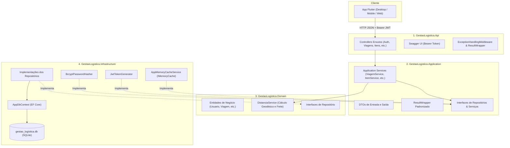

# Trabalho Prático: Sistema de Gestão Logística – API em ASP.NET Core & Flutter

**Disciplina:** Programação para Dispositivos Móveis II  
**Curso:** Gestão da Tecnologia da Informação
**Ano/Período:** 2026 – 6o Período
**Arquitetura:** Cliente-Servidor com API RESTful em ASP.NET Core e Aplicativo Flutter  

---

## 1. Identificação da Equipe
* **Nome do Projeto:** Sistema de Gestão Logística (GestaoLogistica)
* **Integrantes da Equipe:**
  * Matheus de Souza Silva
  * Dudson Luis Narde Araújo
  * Roberto Sobreira Belan

---

## 2. Descrição Geral e Regras de Domínio
O projeto consiste na evolução arquitetural de um sistema de logística e transporte. Toda a persistência, cálculos de negócio e regras operacionais foram centralizados em uma API RESTful em ASP.NET Core (C#), enquanto o aplicativo Flutter atua como cliente consumidor das interfaces HTTP/HTTPS.

### 2.1. Principais Entidades e Regras de Negócio
1. **Transportadoras:** Gestão de parceiros logísticos com tarifas customizadas (`CustoKm` e `CustoPeso`).
2. **Motoristas:** Cadastro com validação de CNH e controle de status (`Disponivel`, `Em Viagem`, `Inativo`).
3. **Veículos:** Cadastro com placa única, tipo (`Carreta`, `Caminhao Bau`, `Fiorino`), capacidade máxima de carga em kg e controle de status (`Disponivel`, `Manutencao`, `Em Viagem`).
4. **Itens de Inventário (Estoque):** Controle de produtos com peso unitário, quantidade em estoque, cidade de armazenagem e localização.
5. **Viagens (Operação Central):**
   * **Cálculo de Frete Baseado em Distância Real:** Utiliza a fórmula geodésica de Haversine entre capitais brasileiras somada à taxa por peso transportado (`distância * custoKm + pesoTotal * custoPeso`).
   * **Validação de Carga:** O peso total dos itens transportados não pode exceder a capacidade máxima do veículo selecionado.
   * **Baixa Atômica de Estoque:** Ao cadastrar uma viagem, a quantidade dos itens transportados é deduzida automaticamente do inventário em uma transação segura.
   * **Transição de Status de Recursos:** Ao iniciar uma viagem, o motorista e o veículo passam automaticamente para o status `Em Viagem`. Ao concluir a viagem (`Concluido`), ambos voltam para `Disponivel`.
   * **Faturamento e Métricas:** Cálculo de faturamento total de viagens concluídas, taxa de eficiência e contagem de cargas em trânsito.

---

## 3. Tecnologias Empregadas

| Componente | Tecnologia / Biblioteca | Versão |
| :--- | :--- | :---: |
| **Backend Framework** | C# / ASP.NET Core (.NET) | 9.0 |
| **Padrão Arquitetural** | Clean Architecture (Domain, Application, Infrastructure, Api) | - |
| **Persistência / ORM** | Entity Framework Core com provedor SQLite | 9.0.2 |
| **Banco de Dados** | SQLite (`gestao_logistica.db`) com migração e seed automático | - |
| **Autenticação & JWT** | Microsoft.AspNetCore.Authentication.JwtBearer + System.IdentityModel.Tokens.Jwt | 9.0.2 |
| **Criptografia de Senhas**| BCrypt.Net-Next (Hash seguro com salt) | 4.0.3 |
| **Cache em Memória** | Microsoft.Extensions.Caching.Memory (IMemoryCache) | 9.0.2 |
| **Documentação da API** | Swashbuckle.AspNetCore (Swagger / OpenAPI com suporte a Bearer Token) | 6.6.2 |
| **Frontend Mobile/Web**| Flutter (Dart) com injeção de dependências | 3.47 / 3.13 |
| **Comunicação HTTP** | `http` com parsing padronizado de `ResultWrapper` | 1.2.2 |
| **Armazenamento de Token**| `shared_preferences` | 2.3.2 |
| **Testes Automatizados** | xUnit com testes unitários e de integração | 9.0 |

---

## 4. Estrutura Arquitetural (Clean Architecture)

A API foi projetada estritamente sob as diretrizes da **Clean Architecture**, dividida em 4 camadas com fluxo unidirecional de dependências:

```
[ Domain ] <────── [ Application ] <────── [ Infrastructure ]
    ▲                                             ▲
    │                                             │
    └───────────────── [ API / Presentation ] ────┘
```



### Papel de Cada Camada:
* **Domain:** Entidades (`Usuario`, `Motorista`, `Veiculo`, `Transportadora`, `ItemInventario`, `Viagem`, `ViagemItem`), regras puras e `DistanciaService`. Não depende de bibliotecas externas nem de infraestrutura.
* **Application:** Casos de uso (`ViagemService`, `ItemInventarioService`, etc.), contratos de entrada e saída (DTOs) e classe genérica `ResultWrapper<T>`.
* **Infrastructure:** Acesso ao banco de dados SQLite via EF Core, repositórios concretos, hashing com BCrypt, emissão de JWT e cache em memória.
* **API / Presentation:** Controllers enxutos (apenas orquestram requisições HTTP), mapeamento de rotas, injeção de dependências, CORS e autenticação.

---

## 5. Guia de Instalação e Execução

### 5.1. Pré-requisitos
* [.NET 9 SDK](https://dotnet.microsoft.com/download/dotnet/9.0) instalado.
* [Flutter SDK](https://flutter.dev/docs/get-started/install) instalado.

---

### 5.2. Executando a API ASP.NET Core
1. Abra um terminal e navegue até a pasta da API:
   ```bash
   cd gestao_logistica_api/src/GestaoLogistica.Api
   ```

2. Execute o projeto com o perfil HTTP:
   ```bash
   dotnet run --launch-profile http
   ```

3. **Pronto!** O banco de dados SQLite (`gestao_logistica.db`) será criado e populado automaticamente na primeira execução (*seeding*).
   * **URL da API:** `http://localhost:5167`
   * **Documentação Interativa (Swagger):** `http://localhost:5167/`

---

### 5.3. Executando os Testes Automatizados da API
Para rodar a suíte completa de testes unitários e de integração (BCrypt, Claims JWT, Cálculo de Frete, Regras de Negócio e Cache Hit/Miss):
```bash
dotnet test gestao_logistica_api/GestaoLogistica.sln
```

---

### 5.4. Executando o Aplicativo Flutter
1. Em outro terminal, navegue até a pasta do aplicativo Flutter:
   ```bash
   cd gestao_logistica_flutter
   ```

2. Baixe as dependências:
   ```bash
   flutter pub get
   ```

3. Execute o aplicativo na plataforma desejada:
   ```bash
   # Para executar no Desktop Linux/macOS/Windows:
   flutter run -d linux   # ou windows, macos

   # Para executar na Web:
   flutter run -d chrome

   # Para executar em emulador Android:
   flutter run
   ```
   *(Nota: O aplicativo já detecta automaticamente o emulador Android e ajusta a Base URL para `http://10.0.2.2:5167/api`, enquanto em Desktop/Web utiliza `http://localhost:5167/api`).*

---

## 6. Segurança, Hash de Senhas e Autenticação JWT

### 6.1. Proteção de Senhas
As senhas nunca são salvas em texto puro. O sistema utiliza a biblioteca **BCrypt.Net-Next** com fator de trabalho 11 (*salt* gerado aleatoriamente e embutido no hash criptográfico).

### 6.2. Estrutura do Token JWT
Ao realizar o login em `POST /api/auth/login`, a API valida as credenciais e devolve um token JWT assinado digitalmente com HMAC-SHA256, contendo as seguintes *claims*:
* `nameid`: ID do usuário.
* `unique_name`: Nome de usuário (`Username`).
* `role`: Papel de acesso (`Admin` ou `Motorista`).
* `is_admin`: Booleano em string (`"true"` ou `"false"`).
* `id_motorista`: ID do motorista associado (quando aplicável).
* `exp`: Timestamp de expiração (configurado para 8 horas de validade).

### 6.3. Credenciais Pré-configuradas para Testes (Seed)

| Usuário | Senha | Perfil | Motorista Vinculado |
| :--- | :--- | :---: | :--- |
| `admin` | `admin123` | **Administrador** | - |
| `joao` | `motorista123` | **Motorista** | Joao da Silva (Frota Própria) |
| `carlos` | `motorista123` | **Motorista** | Carlos Curitibano |
| `pedro` | `motorista123` | **Motorista** | Pedro Paulista |
| `lucas` | `motorista123` | **Motorista** | Lucas Mineiro |

---

## 7. Mecanismo de Cache

O cache foi implementado no serviço de consulta de estoque e inventário (`GET /api/itens-inventario`), utilizando `IMemoryCache` nativo do ASP.NET Core.

### 7.1. Políticas de Expiração
* **Absolute Expiration:** 5 minutos (tempo de vida total do item em memória).
* **Sliding Expiration:** 2 minutos (renovado se o dado for acessado com frequência).

### 7.2. Auditoria e Diagnóstico
Ao realizar uma requisição `GET /api/itens-inventario`, a resposta inclui o cabeçalho HTTP customizado `X-Cache`:
* **`X-Cache: MISS`**: Primeira consulta ou após alteração. A API busca os dados no SQLite e salva na memória cache.
* **`X-Cache: HIT`**: Consultas seguintes. A API responde instantaneamente a partir da memória RAM sem tocar no banco de dados.

### 7.3. Invalidação Reativa
Sempre que ocorre uma alteração no inventário (`POST` novo item, `PUT` edição, `DELETE` exclusão, `PATCH` atualização de estoque ou criação de nova viagem com consumo de itens), a chave de cache é **imediatamente invalidada**. A próxima requisição gerará automaticamente um novo *Cache Miss*, garantindo consistência total dos dados.

---

## 8. Padronização com ResultWrapper

Todas as rotas da API retornam estritamente o formato unificado `ResultWrapper<T>`:

### Exemplo de Sucesso (HTTP 200 / 201):
```json
{
  "success": true,
  "message": "Operação realizada com sucesso.",
  "data": {
    "id": 1,
    "nome": "Televisor LED 55",
    "tipo": "Eletronico",
    "pesoUnitario": 15.0,
    "quantidade": 100,
    "cidade": "Sao Paulo"
  },
  "errors": []
}
```

### Exemplo de Erro / Validação (HTTP 400 / 404 / 500):
```json
{
  "success": false,
  "message": "Excesso de carga.",
  "data": null,
  "errors": [
    "O peso total (800 kg) excede a capacidade máxima do veículo (500 kg)."
  ]
}
```

---

## 9. Catálogo Completo de Endpoints

### 9.1. Autenticação & Usuários (`/api/auth`)
| Método | Endpoint | Autorização | Descrição |
| :--- | :--- | :---: | :--- |
| `POST` | `/api/auth/login` | Aberto | Realiza login e emite o token JWT com claims. |
| `POST` | `/api/auth/register` | Aberto | Registra novo usuário com hash BCrypt. |
| `GET` | `/api/auth/usuarios` | `Admin` | Lista todos os usuários cadastrados. |
| `PATCH` | `/api/auth/usuarios/{id}/ativo` | `Admin` | Ativa ou desativa um usuário no sistema. |

### 9.2. Itens de Inventário (`/api/itens-inventario`) – Com Cache
| Método | Endpoint | Autorização | Descrição |
| :--- | :--- | :---: | :--- |
| `GET` | `/api/itens-inventario` | Autenticado | Lista itens com Cache (`X-Cache: HIT`/`MISS`). |
| `GET` | `/api/itens-inventario/{id}` | Autenticado | Detalha um item específico. |
| `POST` | `/api/itens-inventario` | `Admin` | Cadastra item e invalida o cache. |
| `PUT` | `/api/itens-inventario/{id}` | `Admin` | Atualiza item e invalida o cache. |
| `DELETE`| `/api/itens-inventario/{id}` | `Admin` | Exclui item e invalida o cache. |
| `PATCH` | `/api/itens-inventario/{id}/estoque` | `Admin` | Atualiza quantidade de estoque e invalida cache. |

### 9.3. Transportadoras (`/api/transportadoras`)
| Método | Endpoint | Autorização | Descrição |
| :--- | :--- | :---: | :--- |
| `GET` | `/api/transportadoras` | Autenticado | Lista todas as transportadoras parceiras. |
| `GET` | `/api/transportadoras/{id}` | Autenticado | Detalhes da transportadora. |
| `POST` | `/api/transportadoras` | `Admin` | Cadastra transportadora com custo/km e custo/peso. |
| `PUT` | `/api/transportadoras/{id}` | `Admin` | Atualiza dados e tarifas da transportadora. |
| `DELETE`| `/api/transportadoras/{id}` | `Admin` | Remove transportadora. |

### 9.4. Motoristas (`/api/motoristas`)
| Método | Endpoint | Autorização | Descrição |
| :--- | :--- | :---: | :--- |
| `GET` | `/api/motoristas` | Autenticado | Lista todos os motoristas. |
| `GET` | `/api/motoristas/disponiveis` | Autenticado | Lista apenas motoristas com status `Disponivel`. |
| `GET` | `/api/motoristas/{id}` | Autenticado | Detalhes de um motorista. |
| `POST` | `/api/motoristas` | `Admin` | Cadastra motorista com CNH única. |
| `PUT` | `/api/motoristas/{id}` | `Admin` | Atualiza dados do motorista. |
| `DELETE`| `/api/motoristas/{id}` | `Admin` | Exclui motorista. |

### 9.5. Veículos (`/api/veiculos`)
| Método | Endpoint | Autorização | Descrição |
| :--- | :--- | :---: | :--- |
| `GET` | `/api/veiculos` | Autenticado | Lista todos os veículos da frota. |
| `GET` | `/api/veiculos/disponiveis` | Autenticado | Lista apenas veículos com status `Disponivel`. |
| `GET` | `/api/veiculos/{id}` | Autenticado | Detalhes do veículo. |
| `POST` | `/api/veiculos` | `Admin` | Cadastra veículo com placa e capacidade de carga. |
| `PUT` | `/api/veiculos/{id}` | `Admin` | Atualiza veículo. |
| `DELETE`| `/api/veiculos/{id}` | `Admin` | Remove veículo. |

### 9.6. Viagens e Operações (`/api/viagens`)
| Método | Endpoint | Autorização | Descrição |
| :--- | :--- | :---: | :--- |
| `GET` | `/api/viagens` | Autenticado | Lista todas as viagens cadastradas. |
| `GET` | `/api/viagens/{id}` | Autenticado | Detalhes completos da viagem com itens vinculados. |
| `GET` | `/api/viagens/motorista/{id}` | Autenticado | Lista viagens pendentes/em trânsito do motorista. |
| `GET` | `/api/viagens/historico/motorista/{id}` | Autenticado | Histórico de viagens do motorista. |
| `GET` | `/api/viagens/historico/veiculo/{id}` | Autenticado | Histórico de viagens do veículo. |
| `GET` | `/api/viagens/dashboard` | Autenticado | Faturamento total, eficiência no prazo e viagens ativas. |
| `POST` | `/api/viagens/calcular-frete` | Autenticado | Calcula distância real e custo sugerido de frete. |
| `POST` | `/api/viagens` | `Admin` | Cria viagem, reserva estoque e aloca veículo/motorista. |
| `PATCH` | `/api/viagens/{id}/status` | Autenticado | Atualiza status (ao concluir, libera veículo e motorista). |
| `PATCH` | `/api/viagens/{id}/faturado` | `Admin` | Marca viagem como faturada. |


